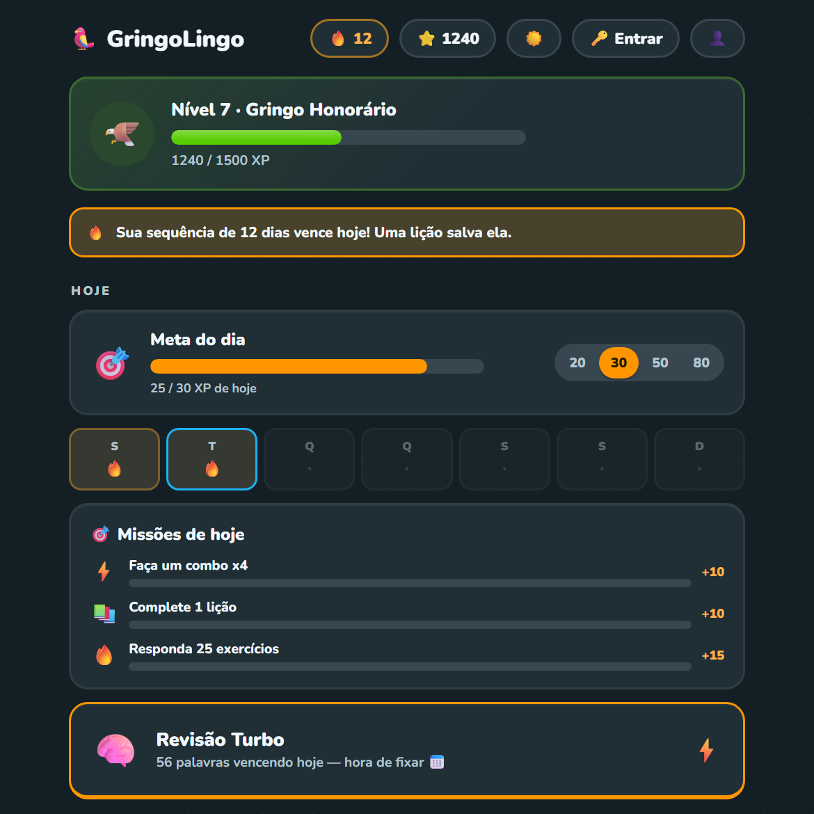
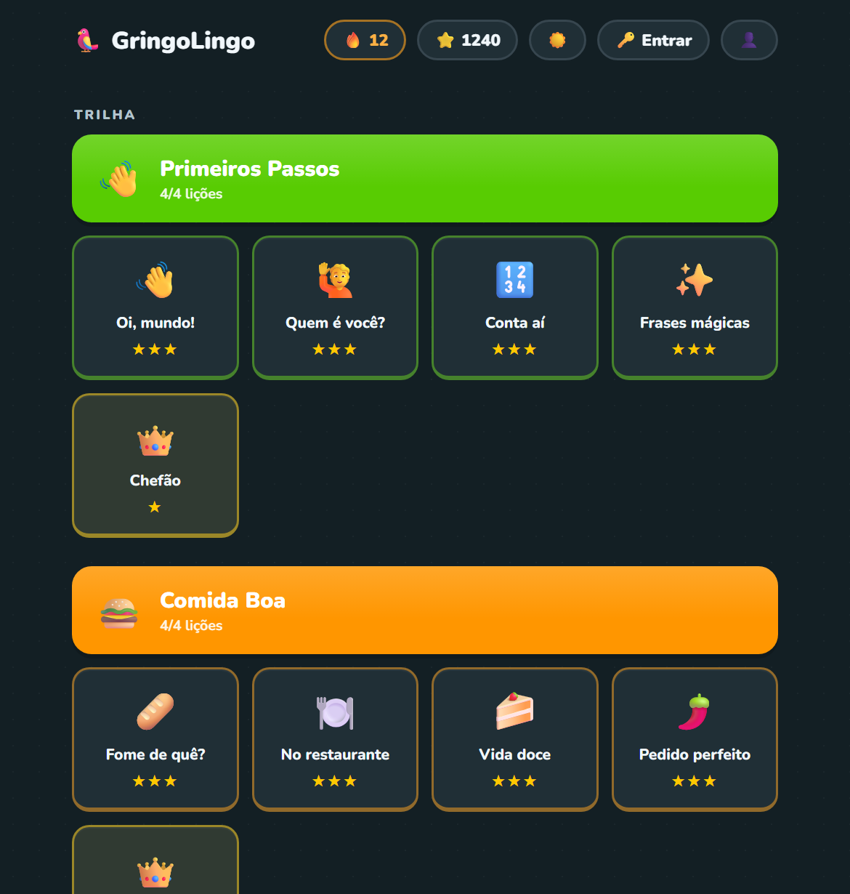
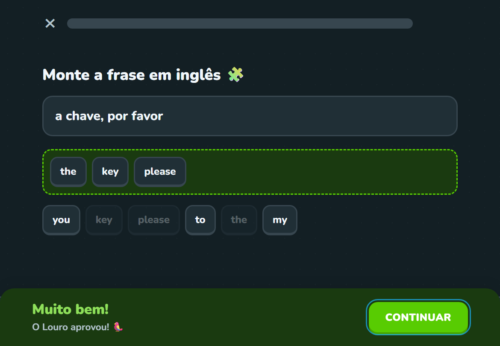
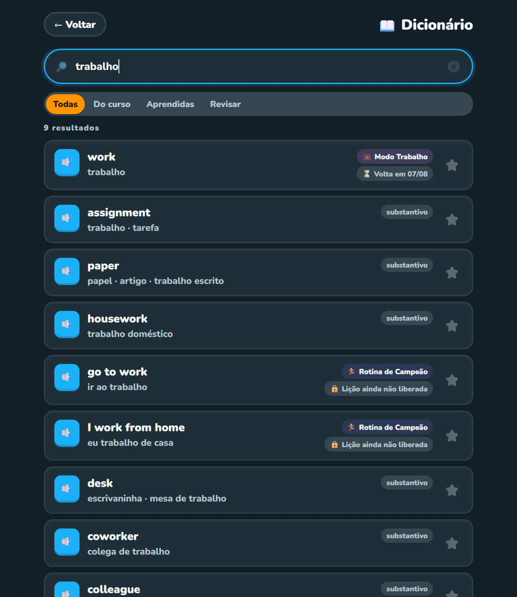
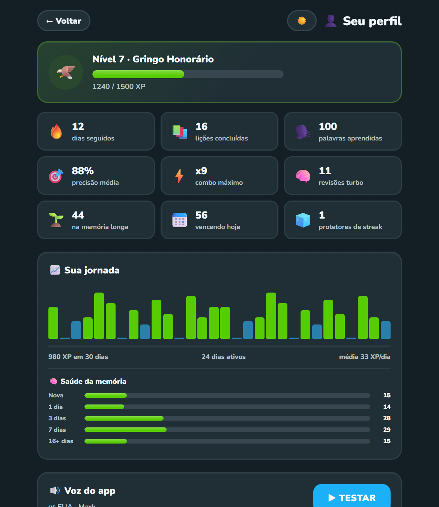
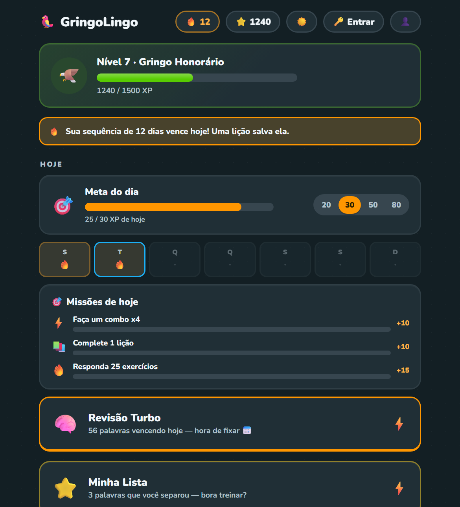
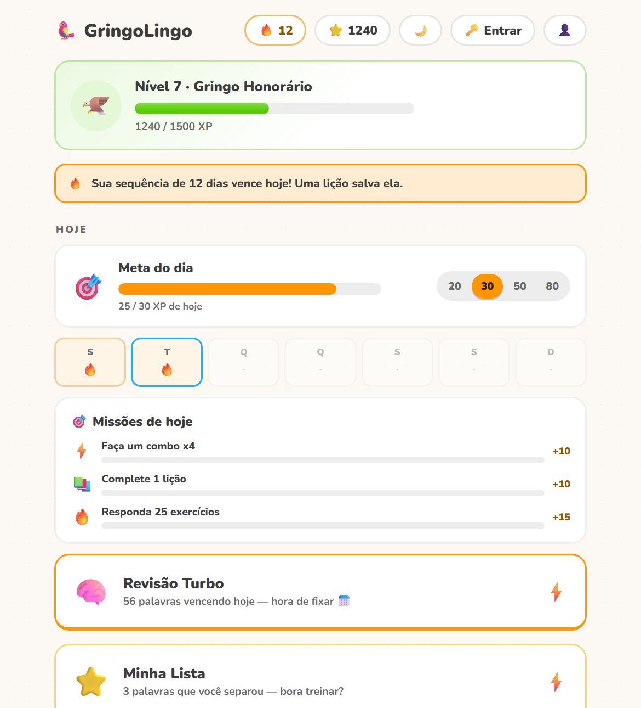

<div align="center">

# GringoLingo 🦜

**Aprender inglês como quem joga: lições de cinco minutos, XP, streak e uma memória que sabe a hora de te cobrar.**

Um curso de inglês completo, com 9 unidades, 10 tipos de exercício, repetição espaçada, dicionário de
3 mil palavras e sincronização entre aparelhos, escrito em **HTML, CSS e JavaScript puro**.
Sem framework, sem bundler, sem `npm install`. O que está no repositório é exatamente o que roda no
navegador.

### ➡️ [**Abrir o app**](https://lucasrmagalhaes.github.io/gringolingo-js/) ⬅️

[](https://lucasrmagalhaes.github.io/gringolingo-js/)
[](#decisões-técnicas)
[](#decisões-técnicas)
[](#testes)
[](https://lucasrmagalhaes.github.io/gringolingo-js/)
[](#arquitetura)



</div>

---

## Por dentro

| A trilha | Um exercício |
| --- | --- |
|  |  |
| Unidades coloridas, desbloqueio progressivo, até 3 estrelas por lição e o **Chefão** no fim de cada unidade. | Montar frase, digitar, ouvir, falar, ligar pares… com uma correção que explica o erro. |

| O dicionário | Sua jornada |
| --- | --- |
|  |  |
| Uma busca só, aceita português ou inglês, com ou sem acento. E mostra em que pé está a sua memória de cada palavra. | Gráfico de XP dos últimos 30 dias e a distribuição das palavras pelas caixas de revisão. |

<div align="center">

| Tema escuro | Tema claro |
| --- | --- |
|  |  |

</div>

---

## O que tem

### Aprendizado

- **9 unidades × 4 lições = 36 lições**, com 247 palavras e frases: Primeiros Passos, Comida Boa,
  Modo Viagem, Modo Trabalho, Família & Amigos, Casa Doce Casa, Corpo São, Rotina de Campeão e Tempo Livre
  (clima, humor, planos e convite). Desbloqueio progressivo e até 3 estrelas por lição.
- **10 tipos de exercício**: múltipla escolha EN→PT e PT→EN, digitar a tradução, montar frase com
  peças, o que você ouviu, o que isso significa, ditado de frase, completar a lacuna, falar em inglês
  (reconhecimento de voz, com botão de pular) e ligar os pares. Todo áudio tem o botão 🐢 para ouvir
  devagar. Se o microfone não existir ou falhar, o exercício de falar abre um campo para escrever a
  frase e corrige com o mesmo tutor.
- **Modo Escuta**: depois de 4 palavras aprendidas, a home abre uma sessão curta. Você ouve a frase
  e escreve. Se o navegador tiver reconhecimento de voz, a cada três rodadas dá para repetir falando.
  Sem microfone, todas as rodadas são escritas e o app avisa. Sem voz em inglês, o card explica e não
  começa. A sessão conta streak, XP e a agenda de Leitner, e não conta como Revisão Turbo. O recorde
  de acertos mescla pelo maior número entre aparelhos.
- **Treinar uma caixa**: no perfil, em Saúde da memória, toque numa faixa que já tem palavras. A
  revisão usa só as palavras daquela caixa, até 8. Palavras ainda sem agenda ficam na caixa de 1 dia.
- **Diálogos guiados**: cinco cenas lineares (pedir comida, check-in, entrevista, papo e caminho) e
  mais cinco em que a conversa muda: médico, aeroporto, loja, telefone e reunião. Você escolhe a
  intenção em português e fala a frase em inglês. O app fala a deixa e você responde no microfone ou
  por escrito. O mesmo tutor explica o erro e mostra um jeito melhor de dizer. Cada cena guarda o
  melhor resultado e conta XP e streak. A conquista das cinco cenas continua só com as primeiras.
- **Sombra**: ouça uma frase, repita e veja a nota. As palavras que faltaram ficam marcadas. Sem
  microfone, dá para escrever. Se o aparelho não tiver voz, um botão mostra a frase. O baralho de
  frases entra nessa fila, e dá para sombrear só ele.
- **Frases de sobrevivência**: pedir para repetir, pedir o sentido, ganhar tempo, concordar,
  discordar e interromper com educação. Praticar (por voz ou por escrito) coloca a frase na agenda
  Leitner. Quando vence, a Revisão Turbo cobra de novo, com a mesma caixa de 1, 3, 7, 16 e 35 dias.
- **Desafio de 5 minutos**: card na home. Mistura um turno de diálogo, sombra e frases. Terminar
  conta sequência e XP. Se o tempo acabar antes do mix completo, a sequência não muda. Sem rede.
- **Ouvir uma cena**: recados curtos de portão, clínica, loja, telefone, reunião e outros. A voz é a
  do aparelho, em velocidade natural ou devagar, sem arquivo de áudio. A pergunta só aparece depois
  que você ouve. Sem voz, o texto em inglês aparece para ler.
- **Pronúncia**: pares mínimos dos sons difíceis para quem fala português: TH, o -ed final, vogal
  curta e longa, e o acento da palavra. Ouça e escolha qual foi. A dica explica o par.
- **Painel da fala**: a nota dos últimos 7 dias e as frases que mais escapam. Diálogo, sombra,
  desafio, pronúncia e escuta alimentam o mesmo painel. O formato da nuvem continua o 3.
- **Teste de nível**: oito perguntas, de A1 a B2. O resultado ordena diálogos, fala rápida,
  phrasal verbs e os temas. Nada fica escondido. Refazer pode baixar o nível neste aparelho.
  Na nuvem, fica o mais alto. A primeira vez conta streak e XP.
- **Você pergunta**: café, loja, aeroporto e reunião. A sua fala é a pergunta. O tutor mostra
  um jeito melhor depois da tentativa.
- **Fala rápida**: gonna, wanna, gotta e palavras que se juntam, como cup of. A voz é a do
  aparelho, normal ou devagar, sem arquivo de áudio. A frase escrita só aparece depois.
- **Phrasal verbs e colocações**: look for, figure out, meet the deadline e outras frases de
  conversa. O treino fica no painel da fala e não entra na Revisão Turbo.
- **Falar de você**: um minuto sobre você, um hobby, o trabalho ou um projeto. O relógio corre
  no aparelho. O tutor olha o tamanho, as pistas e as ligações, sem enviar o texto.
- **Resumo da semana**: a nota de segunda a domingo e uma sugestão. Os contadores de perguntas,
  fala rápida, phrasal verbs e fala livre são do tempo todo.
- **Inglês de trabalho**: standup, explicar um bug, code review, entrevista remota e demo. A ordem
  segue o nível, de A1 a B2, e nada fica trancado. A conquista das cinco cenas não muda.
- **Sua voz ao lado do modelo**: grave até 8 segundos e ouça depois da tentativa, junto com a voz
  do aparelho. O áudio não entra no progresso, no backup nem na nuvem. Sem microfone, dá para escrever.
- **Pergunta do dia**: uma pergunta de trabalho e uma segunda em seguida. A data local escolhe a
  pergunta. Refazer no mesmo dia conta de novo, e a nuvem fica com a data mais nova.
- **Idioms de reunião**: touch base, heads up, circle back e outras frases de call remota. O treino
  fica no painel da fala e não entra na Revisão Turbo.
- **Deslizes de fala**: a frase que escapou em qualquer modo volta na data. Acertar empurra para
  1, 3, 7, 16 ou 35 dias. Errar traz para amanhã. Na nuvem fica a data mais cedo. Não entra na
  Revisão Turbo das palavras.
- **Entrevista longa**: seis falas seguidas para uma vaga full stack e remota. Você se apresenta,
  conta um projeto, um bug, o trabalho remoto, sugere uma mudança e faz uma pergunta.
- **Contar no passado**: histórias curtas em duas falas, como o trem, o almoço e o mercado.
- **Números, datas e preços**: ouça a voz do aparelho e escolha o valor. A frase escrita só aparece
  depois. Sem voz, dá para ler.
- **Por onde começar**: quem ainda não tem XP vê três caminhos na home: a primeira lição, o teste
  de nível ou a pergunta do dia.
- **Opinião**: dê um motivo e, na fala seguinte, concorde ou discorde com educação. A frase modelo
  só aparece depois da tentativa.
- **Descrever a cena**: quatro situações, sem imagem. Você diz o que acontece e depois um detalhe.
- **Pensa em inglês**: quatro respostas curtas, vinte segundos cada. Se o tempo acaba, a frase modelo
  aparece. O relógio é deste aparelho.
- **Meta de falas da semana**: 2, 3, 5 ou 7 treinos, de segunda a domingo. O lembrete fica na home e
  no resumo. O app não pede aviso do celular. A semana conta uma vez só.
- **Relatar um bug**: três falas, nesta ordem: como repetir, a causa e a correção. A cena curta de
  bug do inglês de trabalho continua no lugar.
- **Review com educação**: você pede a mudança e, na fala seguinte, agradece um comentário.
- **Antes da reunião**: fim de semana, clima e viagem, em duas falas curtas.
- **Esclarecer**: peça para repetir, fale mais devagar ou confirme com "so what you're saying is".
  A frase em inglês só aparece depois da tentativa.
- **Pular para o conteúdo**: o atalho fica escondido até receber o foco. As barras de progresso do
  nível e da meta do dia têm nome para leitor de tela. Depois de uma resposta, o foco vai para o
  retorno do tutor.
- **Demo de produto**: um minuto para apresentar a feature e duas respostas da plateia. A cena curta
  de demo do inglês de trabalho continua no lugar.
- **Prazo e escopo**: sugira com "I'd suggest" e peça com "Could we", em duas falas.
- **Entrevista STAR**: situação, tarefa, ação e resultado. A entrevista longa de vaga continua no lugar.
- **Ênfase**: marque a palavra forte, ou se a pergunta sobe ou desce, e depois diga a frase.
- **Decisão técnica**: duas falas, a escolha e a troca, com "we went with" e "the trade-off".
- **Pair**: narre o que está fazendo e peça ajuda, em duas falas.
- **Plantão**: status, desculpa e o próximo passo, em três falas.
- **Retrospectiva**: três falas, o que foi bem, o que melhorar e a ação da sprint.
- **Onboarding**: explique o projeto, o fluxo do time e a primeira tarefa.
- **Conectores**: ligue duas ideias com however, on the other hand ou that said.
- **Feedback 1:1**: ouça um ponto do gestor e devolva um pedido, em duas falas.
- **Pergunta final**: no fim da entrevista, pergunte do time, dos 90 dias ou do que é difícil.
- **Viagem a trabalho**: conexão, imigração e táxi, em duas falas.
- **Três minutos**: mistura frases dos treinos num relógio de 3 minutos. O tempo não envia sozinho.
- **Linha a linha**: explique o loop, o callback e o null check, e nomeie o edge case. A frase modelo só aparece depois.
- **Slack**: escreva ou fale um recado curto para pedir review ou avisar atraso.
- **Happy hour**: um brinde, o violão no fim de semana e o papo de ser do Brasil.
- **Termos técnicos**: o som de cache, queue, SQL, GUI, height e width, e uma frase de uso.
- **Tema e relógio**: o botão de tema diz para onde vai, e o relógio da revisão de 3 minutos atualiza a cada segundo.
- **Salário**: faixa anual, plano de saúde e ações, em duas falas.
- **Portfólio**: problema, stack e resultado de um projeto pessoal, em três falas.
- **Sotaques**: ouça en-US, en-GB e en-IN na voz do aparelho, quando ela existir.
- **Desafio do dia**: começa com 2 frases e ganha uma por dia seguido, até 6.
- **Cartões**: o ícone e a seta dos treinos ficam no mesmo tamanho, para o título alinhar.
- **Requisitos**: pergunta de descoberta e confirmação do que você entendeu, em duas falas.
- **Métricas**: números, porcentagens e crescimento, por extenso ou em dígitos.
- **Um erro**: o erro, o efeito e a lição, em três falas.
- **Só áudio**: lê a pergunta em voz alta e espera a resposta, para treinar andando.
- **Microfone**: sair da tela interrompe o reconhecimento, para ele não escrever numa tela que já fechou.
- **Palestra**: abertura, troca de slide e convite às perguntas, em duas falas.
- **Sem a resposta**: ganhe tempo, diga que o número não está aqui e marque quando volta.
- **Sinal ruim**: a voz corta, o vídeo trava e a chamada cai.
- **Por que falhou**: sintoma e causa de um deploy, de um CI vermelho e de uma permissão, em duas falas.
- **Mentoria**: nomeie a função, escreva um teste que mostra o bug e mude um arquivo de cada vez.
- **No exterior**: farmácia, febre e ambulância, em duas falas.
- **Treinos iguais**: a lista, a abertura e a pintura dos treinos de fala passam pelos mesmos três ajudantes.
- **Fonte**: a Nunito começa a baixar junto com a página, para o texto não pular quando a fonte chega.
- **Cartões no celular**: os botões de treino ficam no leitor de tela. A pintura atrasada passa para as conquistas, que não são botões.
- **Sistema**: pedido, escala e gargalo, em duas falas. A frase modelo só aparece depois.
- **Em voz alta**: o caso vazio, o loop lido em voz alta e o passo do erro.
- **Outra área**: peça e ofereça ajuda a design, QA e produto.
- **Simulado**: seis falas de treinos que já existem, com uma nota no fim.
- **Mesma nota**: a faixa do simulado é o subtítulo da média que o resultado já mostra.
- **Para leigos**: prompt, alucinação e RAG, em duas falas simples. A frase modelo só aparece depois.
- **O furo**: CVE, patch e upgrade de dependência, com o aviso e o plano.
- **Em casa**: manhã, jantar e noite em família, fora do papo de trabalho.
- **Conversa livre**: três assuntos do dia, cada um com uma pergunta de acompanhamento. O mesmo dia repete os mesmos assuntos.
- **Grupos**: os treinos de fluência ficam em Trabalho, Entrevista, Dia a dia, Pronúncia e Revisão, com busca pelo nome.
- **Treino recomendado**: o próximo treino sai do teste de nível, dos pontos fracos e do histórico.
- **Daqui a cinco anos**: a meta e o caminho da carreira, em duas falas.
- **Auditoria**: idioma, foco e o tamanho do JS conferidos nos testes, sem rede.
- **Trilha de 30 dias**: o dia fica no topo do hub e o treino do dia é o recomendado.
- **Esporte, filme e série**: um papo cultural em duas falas, fora da rotina de casa.
- **O aumento**: peça o aumento, fale da promoção e de uma entrega.
- **A API**: explique o endpoint, o status e o token em voz alta.
- **Ao vivo**: status do incidente, pedido de ajuda e a lição, em duas falas.
- **Com o produto**: negocie o que fica nesta entrega e o que espera.
- **Suas perguntas**: plantão, crescimento e por que a vaga abriu.
- **Mais erradas**: as frases que você errou duas vezes ou mais voltam na data da revisão.
- **O mapa**: explique a arquitetura e o fluxo para quem chegou agora, em duas falas.
- **O ponto difícil**: dê e receba um feedback duro no 1:1, sem repetir o elogio.
- **A proposta**: apresente uma RFC e o preço da escolha, antes da decisão tomada.
- **Semana falada**: o painel mostra os minutos de fala e os treinos de cada grupo.
- **O par narrado**: pense a próxima linha em voz alta, com o par.
- **Banco ou cache**: explique sessões, cache ou busca numa entrevista de sistema.
- **O não educado**: recuse um pedido e ofereça outro caminho.
- **Meta de minutos**: escolha 10, 20, 30 ou 45. O lembrete fica na tela e não pede aviso do celular.
- **Demo da sprint**: mostre o que saiu e responda uma pergunta.
- **A decisão segura**: fale de um furo, de um patch ou de apagar um dado.
- **No meetup**: puxe assunto num evento de tecnologia.
- **Entrevista completa**: cinco treinos em sequência e a mesma nota do simulado.
- **A mesa da retro**: fato, ajuste e quem fica com a ação. A retro antiga, de bem e melhorar, continua no catálogo.
- **A migração**: explique a troca de banco ou de biblioteca e o risco.
- **Primeiro dia**: um oi informal no time novo, fora do onboarding do projeto.
- **Entrevista por foco**: escolha frontend, backend ou IA. A nota fica neste aparelho.
- **A carta**: vote a estimativa e diga o motivo, em duas falas.
- **A conta da IA**: custo, busca nos documentos e o molde que a pessoa ainda lê.
- **A ligação**: pretensão, fuso e quando você pode começar, numa call com o recrutador.
- **Backup local**: o arquivo JSON usa a data deste aparelho e o leitor de tela ouve o nome.
- **A desculpa**: assuma um erro seu e diga o próximo passo, sem apontar outra pessoa.
- **O relâmpago**: cinco minutos sobre um projeto pessoal.
- **A oferta**: notebook, verba de estudo e a data de início.
- **Sombra**: o mesmo dia repete a ordem. A voz do aparelho lê a frase, e a nota diz qual palavra faltou.
- **Não entendi**: peça o sotaque e a palavra que escapou.
- **A cobertura**: diga que os testes rodam em todo push, o que a cobertura mostra e que a suíte fica sem rede.
- **O vídeo**: um check-in de dois minutos, com o link na thread e sem reunião.
- **Meu vocabulário**: as palavras que escaparam nas falas ficam neste aparelho para revisar numa frase.
- **O gráfico**: leia a alta, a queda e a causa, sem repetir a métrica de cadastro.
- **O handoff**: peça o que ficou aberto e deixe a nota para o outro fuso.
- **O elevador**: trinta segundos para um diretor, do time ao pedido de uma folha.
- **A semana junta**: um treino só com o vocabulário, as frases mais erradas e a meta de minutos.
- **O bug raro**: conte o sintoma e a prova de um bug que só falha às vezes, com o log na mão.
- **Com calma**: explique uma promessa ou a caixa vazia, um passo de cada vez.
- **A folga**: fale da primeira semana de dezembro, do limite das sete e de duas semanas fora.
- **Perguntas abertas**: cinco perguntas de entrevista do dia. Cada resposta conta palavras e tempo, marca um, like e basically, e sugere um conector.
- **Com respeito**: discorde de uma arquitetura e ofereça outro caminho, sem repetir o meio-termo.
- **A dívida**: explique o atalho, os juros e peça duas sprints para refatorar.
- **A indicação**: peça a um ex-colega para ser referência, com uma nota curta.
- **O contraste**: explique o cinza, o anel de foco e o rótulo do ícone para quem desenha a tela.
- **O fórum**: descreva a lista vazia, a página antiga e o segundo clique, e diga o que já tentou.
- **O visto**: fale de visto, de três meses para mudar e de quatro horas de sobreposição a partir do Brasil.
- **O mês**: quatro semanas neste aparelho, com nota, minutos e preenchimentos. A primeira visita não entra na média.
- **O facilitador**: abra a reunião pela meta, olhe os cinco minutos e feche com o dono da nota.
- **A escolha**: explique React ou Vue, SQL ou documento, TypeScript ou JavaScript puro.
- **O sábado**: conte a trilha, o domingo na cozinha e um filme sem planos grandes.
- **Treino surpresa**: um treino por dia, com uma sequência só deste modo. O protetor do estudo não entra aqui.
- **A falha**: explique a consulta colada, a escrita sem permissão e o segredo na página, e diga o conserto.
- **A mudança**: a tela nova não estava no escopo, empurra duas semanas e pede uma nota por escrito.
- **O chimarrão**: Rio Grande do Sul, chimarrão de tarde, churrasco de domingo e Porto Alegre.
- **Descoberta**: estrela de favorito, continuar de onde parou e ordenar pelos menos praticados.
- **O radar**: explique a latência p95, o alerta do orçamento de erro e os três gráficos do plantão.
- **O aplauso**: agradeça o time em público, cite quem publicou a correção e aplauda o suporte.
- **A gripe**: avise que está doente, peça a daily sem você e diga a hora da consulta.
- **Com o PM**: peça dois dias para a review, diga que quarta só fecha sem os testes e mande a data nova.
- **O laudo**: conte os doze minutos, o índice que faltava e quem fica com a ação até segunda.
- **O rumo**: peça feedback de carreira, uma área maior e o que muda no próximo nível.
- **O acesso**: mostre o wiki, convide para o repositório e diga a quem chamar se o build falhar.
- **A licença**: peça a ferramenta de desenho, o preço de quarenta dólares e a renovação de sexta.
- **Sem jargão**: diga que o botão novo foi desligado e que a página voltou à versão antiga.
- **A bandeira**: dez por cento vê o botão, e dá para desligar a bandeira sem publicar de novo.
- **O gelo**: sem merge depois das quatro, com exceção de hotfix até sexta de manhã.
- **O limite**: cem chamadas por minuto, a API responde 429 e o teto sobe para duzentos.
- **O canário**: uma máquina recebe a versão antes, e o canário diz se passou.
- **A despedida**: o caminho velho fecha em junho e o novo está no guia.
- **A repetição**: o mesmo evento pode chegar duas vezes e a segunda não muda nada.
- **A carga**: o teste de carga rodou dez minutos numa cópia, com erro abaixo de um por cento.
- **O boletim**: a nota lista três correções, fica no topo e aparece na segunda.
- **Quem aprova**: a pasta tem dois donos e o merge espera um deles.
- **O manual**: o manual manda ler o alerta primeiro e fica no wiki do time.
- **O lado verde**: o tráfego vai para o lado verde.
- **O certificado**: o certificado vence na sexta e o aviso sai antes.
- **O rebase**: a branch está atrás da main.
- **A consulta**: a consulta leva quatro segundos e roda em cada carga de página.
- **A réplica**: a réplica está atrás da principal.
- **O ensaio**: o teste vai para o ensaio antes da produção.
- **O disco**: o disco está noventa por cento cheio.
- **A página**: a lista mostra vinte linhas.
- **O grupo**: no hub, o grupo com menos prática, com atalho para filtrar.
- **O squash**: três commits viram um só antes do merge.
- **O circuito**: o circuito abre depois de cinco erros.
- **O job**: o job roda às três da manhã.
- **A colheita**: um commit sobe sozinho.
- **A sessão**: a sessão acaba depois de oito horas.
- **O tanque**: o tanque enche com vinte conexões.
- **A sonda**: a sonda falhou duas vezes e a gente olha de novo.
- **A semente**: a semente enche o banco vazio com dez linhas.
- **O registro**: suba o registro para debug quando o erro voltar.
- **O rastro**: o id da chamada fica no cabeçalho e vai para o ticket.
- **A parada**: a parada começa à meia-noite e dura uma hora.
- **O pod**: reinicie só um pod e deixe os outros no ar.
- **O lint**: o lint falhou em dois arquivos.
- **A origem**: o navegador bloqueia a outra origem.
- **O link**: o link assinado vale uma hora e depois expira.
- **O processador**: o processador fica perto de noventa por cento.
- **A cópia**: a cópia da noite começa às duas.
- **O estouro**: o processo estourou a memória.
- **O impasse**: dois trabalhos esperam um pelo outro.
- **O domínio**: o nome do site não resolve.
- **A carta morta**: a carta morta guarda o motivo da recusa.
- **Os ponteiros**: os relógios diferem e a assinatura falha.
- **A eleição**: o líder antigo saiu e dois de três concordam.
- **O freio**: a fila encheu e o produtor desacelera.
- **A pausa**: a coleta parou o processo por dois segundos.
- **A deriva**: a configuração publicada difere do arquivo.
- **O descritor**: o processo abriu arquivos demais.
- **A reserva**: o servidor usou a reserva.
- **A varredura**: a tela dispara uma consulta para cada linha.
- **A porta**: nenhum processo escuta nessa porta.
- **O inodo**: os nomes livres acabaram.
- **A saída**: o serviço espera as tarefas abertas.
- **A manada**: o cache venceu de uma vez e a enxurrada caiu.
- **A última**: no hub, há quantos dias foi a última fala, com atalho para a semana.
- **O gotejo**: a memória cresce sem parar.
- **O frio**: a função dorme e a primeira chamada espera.
- **O cadeado**: o processo tentou ler e a permissão recusou.
- **A primeira**: no hub, há quantos dias foi a primeira fala, com atalho para a semana.
- **A cota**: a cota do usuário fechou.
- **O ciclo**: o serviço cai e volta sozinho sem ficar estável.
- **O zumbi**: o filho terminou e o pai nunca colheu o fim.
- **O hiato**: no hub, o maior vão entre dois dias com fala, com atalho para a semana.
- **A cisão**: dois nós mandam juntos e a escrita divide.
- **A rajada**: os clientes tentam juntos e a carga cresce.
- **A brasa**: uma chave recebe quase todas as escritas.
- **O costume**: no hub, o dia da semana em que a fala mais aparece, com atalho para a semana.
- **O datagrama**: dois datagramas sumiram antes de chegar.
- **O passe**: o passe curto venceu.
- **O carimbo**: o carimbo da linha mudou.
- **A marca**: no hub, a maior sequência seguida de fala, com atalho para a semana.
- **A pilha**: a pilha de chamadas cresceu sem fundo.
- **O cano**: a outra ponta fechou o cano.
- **O giro**: o navegador girou entre dois endereços.
- **O auge**: no hub, o dia com mais segundos de fala, com atalho para a semana.
- **A compactação**: o armazenamento reescreveu seis arquivos velhos.
- **O diário**: o diário ocupou quatro gigabytes.
- **O vagão**: o leitor ficou mil mensagens atrás.
- **O sete**: no hub, quantos dos últimos 7 dias tiveram fala, com atalho para a semana.
- **A corrida**: dois pedidos gravaram o mesmo saldo.
- **O índice**: a busca leu cada linha sem índice.
- **O percentil**: noventa e nove por cento cabe no prazo.
- **A soma**: no hub, a soma dos minutos de fala até hoje, com atalho para a semana.
- **O segredo**: a chave secreta apareceu no log.
- **O fantasma**: a segunda leitura viu uma linha nova.
- **O inteiro**: o contador passou do limite e voltou para zero.
- **Por dia**: no hub, a média de minutos por dia com fala, com atalho para a semana.
- **O filtro**: o filtro deu um sim falso e a chave não estava.
- **A ordem**: a mensagem quatro chegou antes da três.
- **A prova**: a prova dos bytes não bateu com o arquivo.
- **A parte**: no hub, quantos minutos desta semana entram na soma de fala, com atalho para a semana.
- **O órfão**: a linha filha apontou para um pai ausente.
- **O aceno**: o segundo sítio nunca confirmou.
- **O gasto**: três dias de erro gastaram o mês.
- **O fora**: no hub, os minutos de fala que ficaram fora desta semana, com atalho para a semana.
- **A duração**: no hub, quanto dura cada treino desta semana, com atalho para a semana.
- **A meta**: no hub, os minutos que ainda faltam para a meta desta semana, com atalho para a semana.
- **A lacuna**: no hub, os dias desta semana ainda sem fala, com atalho para a semana.
- **O ritmo**: no hub, os minutos por dia com fala nesta semana, com atalho para a semana.
- **Os dias**: no hub, quantos dias desta semana tiveram fala, com atalho para a semana.
- **A nota**: no hub, a nota média desta semana, com atalho para o mês.
- **O apoio**: no hub, quantos preenchimentos esta semana teve, com atalho para o mês.
- **O pico**: no hub, o dia desta semana com mais minutos de fala.
- **O acerto**: no hub, a taxa de acerto desta semana, com atalho para o histórico.
- **A estrela**: no hub, o favorito que ainda não teve prática, com atalho para a lista.
- **A palavra**: no hub, a palavra que mais volta nas falas, com atalho para repetir.
- **Semana anterior**: no hub, os minutos até o mesmo ponto da semana anterior.
- **Sequência**: no hub, os dias seguidos de fala, com aviso se a de ontem ainda vale.
- **Sem prática**: no hub, quantos treinos ainda não tiveram prática e qual é o próximo.
- **Hoje**: no hub, se já houve fala hoje, com os minutos e a quantidade de treinos.
- **Para rever**: no hub, a frase que vence hoje, com a dica em português e sem a resposta em inglês.
- **Esta semana**: no hub, os minutos contra a meta e o grupo com menos prática, com o número no texto.
- **Catálogo**: ids e títulos únicos, pares parecidos demais aparecem na auditoria, e a lista do hub não pinta o que está fora da tela.
- **Estimativa**: diga "it should take about" e "I am not sure yet, but", em duas falas.
- **Consenso**: discorde com um motivo e proponha um meio-termo.
- **Atendimento**: ligue para o banco, a entrega ou o hotel, em três falas.
- **Histórico de fala**: os últimos 14 dias no painel, com treinos e taxa de acerto. Sem rede.
- **Fala da tela**: o áudio do diálogo e da sombra cancela quando você sai da tela.
- **Próxima**: o botão entre falas diz PRÓXIMA, e a confirmação de apagar a conta cancela ao sair da tela.
- **Gravação**: o botão volta para GRAVAR quando os 8 segundos acabam, e cada treino do plano tem um nome para leitor de tela.
- **Plano da semana**: o resumo sugere até três treinos a partir dos deslizes e dos padrões do tutor.
- **Celular**: o topo respeita a área segura e o título da tela pode quebrar a linha.
- **Busca do dicionário**: a lista vazia ordena só as palavras do curso, e "vence hoje" usa o dia
  local do aparelho.
- **Parceiro de conversa (opcional, desligado)**: bate-papo em inglês no seu nível, com correção
  depois de cada fala. Liga no perfil com uma chave do Google AI Studio. A chave fica só neste
  aparelho: não entra no backup nem na nuvem. Sem chave e sem rede, diálogos e sombra seguem offline.
- **Chefão de unidade**: liberado quando as 4 lições estão feitas. 12 exercícios difíceis, sem
  múltipla escolha, com 3 vidas.
- **Correção que perdoa o que é para perdoar**: contrações (`don't` = `do not`), traduções
  alternativas por item, pontuação, acento e um errinho de letra (uma a mais, a menos, trocada, ou
  duas vizinhas invertidas), desde que o errinho não forme outra palavra real: `house` nunca vale
  como `mouse`, e `launch` não vale como `lunch`.
- **Tutor que explica o porquê**: ao errar ou quase acertar, o app diz em português o que aconteceu
  (letra, palavra faltando ou sobrando, ordem, artigo, plural, tempo verbal ou falso amigo), destaca
  a diferença e mostra uma dica curta daquele erro. Funciona offline, com regras e um banco local.
  Sem API. Itens com nota de gramática continuam ensinando na hora, e as lições que têm card de
  estrutura abrem com ele na primeira vez.
- **Dica na hora**: botão 💡 na lição (tecla **D**) reabre a explicação da lição e a nota da frase.
  A home mostra a dica do dia, e dá para esconder até amanhã.
- **Pontos fracos**: cada erro entra numa contagem por palavra e por padrão. A Revisão Turbo cobra
  primeiro o que você mais erra. A tela Meus pontos fracos lista os padrões que mais voltam, e cada
  um tem um botão para treinar só as palavras daquele erro. Acertar de novo abaixa o saldo da palavra.
- **Revisão espaçada de verdade (Leitner)**: cada palavra tem uma caixa e volta a ser cobrada em
  1, 3, 7, 16 e 35 dias. Acertou, sobe de caixa; errou, desce uma caixa e reaparece amanhã (só dois
  erros seguidos zeram. Um tropeço não apaga semanas de espaçamento). A home mostra quantas
  palavras vencem hoje. O dia do app é o **dia local do aparelho**. Streak e missões viram à
  meia-noite, não às 21h.
- **Expansão de Vocabulário**: as 2.700+ palavras mais frequentes do inglês (o banco inteiro do
  dicionário) viram lições jogáveis de 7 palavras, em quatro trilhas por classe gramatical com
  desbloqueio sequencial. **Toda palavra que você nunca viu é apresentada antes de ser cobrada**.
  Grafia, pronúncia, classe e traduções. E depois entra na mesma agenda de revisão espaçada do
  curso. Sinônimos com a mesma tradução se aceitam mutuamente na digitação e nunca competem na
  múltipla escolha.
- **Minha Lista**: favorite palavras no dicionário e treine só elas.
- **Dicionário embutido**: 3.001 verbetes (os 247 do curso mais um banco das palavras mais frequentes do
  inglês), com classe gramatical, áudio e, para as do curso, o status da sua memória (🌱 memorizada,
  📅 vencendo hoje, ⏳ volta em 07/08…). Carregado sob demanda, só quando você abre a tela.

- **O orquestrador**: o coordenador dispara a sequência.
- **A coreografia**: o vizinho escolhe a etapa seguinte.
- **A compensação**: a falha desfaz a etapa anterior.
- **A cadência**: no hub, os dias de fala por semana do intervalo, com atalho para a semana.
- **O primário**: só um nó aceita a escrita nova.
- **O espelho**: a cópia acompanha sem aceitar escrita.
- **A ascensão**: a cópia vira dona quando o primário cai.
- **A densidade**: no hub, os minutos de fala por semana do intervalo, com atalho para a semana.
- **A travessia**: o cache confirma a escrita no disco na hora.
- **A retaguarda**: a página suja espera no cache antes do disco.
- **O contorno**: a escrita grande segue direto ao armazenamento.
- **O peso**: no hub, a parte do dia mais longo no total de fala, com atalho para a semana.
- **O rumor**: os nós espalham o estado de boca em boca.
- **O reparo**: a leitura conserta a cópia que ficou atrás.
- **A deixa**: o vizinho guarda a escrita até o dono voltar.
- **A sobra**: no hub, os minutos de fala fora do dia mais longo, com atalho para a semana.
- **O floco**: o id nasce do tempo do nó e de um contador.
- **A época**: a geração sobe quando a formação muda.
- **O vetor**: o nó anota a própria visão dos eventos.
- **O resto**: no hub, os segundos de fala que não fecham um minuto, com atalho para a semana.
- **A sujeira**: a leitura pega um valor que ainda não fechou.
- **O instantâneo**: a consulta olha o banco parado na abertura.
- **O serial**: o resultado cabe numa ordem só de transações.
- **O grão**: no hub, a média de segundos de fala por dia, com atalho para a semana.
- **A fome**: a tarefa espera e nunca ganha a vez.
- **A inversão**: a tarefa baixa segura o recurso da alta.
- **A idade**: a espera longa sobe a prioridade.
- **O curto**: no hub, o dia de fala com menos segundos, com atalho para a semana.
- **O sidecar**: o ajudante mora ao lado e entrega a chamada.
- **O embaixador**: um proxy único representa quem chama de fora.
- **O adaptador**: a tradução liga o cliente antigo à API nova.
- **O longo**: no hub, o dia de fala com mais segundos, com atalho para a semana.
- **O bizantino**: um nó mente e os outros ainda concordam.
- **A partição**: a rede se divide e os lados não se veem.
- **O general**: dois exércitos só avançam com a mesma ordem.
- **O salto**: no hub, a diferença de segundos entre o dia mais longo e o mais curto, com atalho para a semana.
- **O wal**: a escrita entra no log antes da tabela.
- **O lsn**: o número do registro só avança.
- **O checkpoint**: o marco grava um ponto seguro.
- **A mediana**: no hub, o segundo do meio entre os dias de fala, com atalho para a semana. O meio continua contando treinos.
- **O nonce**: o número entra uma vez e não volta.
- **O hmac**: o selo confere a mensagem e a chave.
- **O envelope**: a chave viaja dentro de outra chave.
- **O mosaico**: no hub, quantos grupos de treino já tiveram prática, com atalho para a semana.
- **O lease**: a trava alugada vale só por um tempo.
- **A renovação**: a trava ganha tempo antes de cair.
- **O vencimento**: a trava solta quando o tempo acaba.
- **O turno**: no hub, dias úteis e de fim de semana com fala, com atalho para a semana.
- **O outbox**: a mensagem espera fora antes de sair.
- **O inbox**: a mensagem entra e espera a sua vez.
- **O relay**: o posto repassa a mensagem adiante.
- **A virada**: no hub, quantos meses já tiveram fala, com atalho para a semana.
- **O offset**: o leitor marca até onde já leu.
- **O lag**: o leitor fica atrás do escritor.
- **O ack**: o leitor confirma o trecho lido.
- **A faixa**: no hub, quantas semanas já tiveram fala, com atalho para a semana.
- **O snapshot**: a foto guarda o banco naquele instante.
- **O restore**: a foto devolve o banco ao instante salvo.
- **O promote**: a cópia vira o banco principal.
- **A abertura**: no hub, o dia da semana em que a fala começou, com atalho para a semana.
- **O bloom**: o filtro pode dizer que a chave está lá.
- **O cuco**: a chave muda de ninho quando o lugar enche.
- **O esboço**: o desenho guarda uma conta pequena.
- **A estação**: no hub, a época do ano em que a fala começou, com atalho para a semana.
- **O merkle**: a árvore resume as folhas num selo.
- **O radix**: a árvore corta o prefixo comum.
- **O trie**: a árvore guarda a palavra letra a letra.
- **O fecho**: no hub, o dia da semana em que a fala fechou, com atalho para a semana.
- **O gossip**: os nós trocam o estado entre si.
- **O phi**: a suspeita sobe com a pausa.
- **O accrual**: a falha soma aos poucos.
- **A ausência**: no hub, o nome do grupo que a fala ainda não tocou, com atalho para esse grupo.
- **O hint**: a dica aponta a linha.
- **O vacuum**: a limpeza devolve o espaço.
- **O freeze**: a linha antiga fica para leitura.
- **A prática**: no hub, o próximo treino para praticar, com atalho para começar.
- **O bitmap**: o mapa marca o bit da chave.
- **O roaring**: os bits iguais viram um intervalo.
- **O hyper**: a conta estima itens distintos.
- **O reforço**: no hub, o próximo treino do grupo que você já falou, com atalho para começar.
- **O crdt**: as edições se juntam sem trava.
- **O lww**: a escrita mais nova vence o campo.
- **O orset**: o item fica até a remoção aparecer.
- **O recado**: no hub, o treino do último grupo que a fala ainda não tocou, com atalho para começar.
- **O vector**: cada nó guarda o próprio relógio.
- **O dot**: o ponto nomeia uma escrita.
- **O causal**: a causa chega antes do efeito.
- **A vez**: no hub, o favorito ainda sem fala, com atalho para começar.
- **O shard**: o pedaço guarda uma parte da chave.
- **O rebalance**: as partes trocam de lugar.
- **O split**: a parte grande vira duas.
- **O retorno**: no hub, a frase de fala que já venceu, com atalho para dizer de novo.
- **O watermark**: a marca mostra até onde a leitura chegou.
- **O barrier**: a barreira espera o lote inteiro.
- **O align**: as linhas ficam na mesma altura.
- **A ficha**: no hub, a palavra de vocabulário que já venceu, com atalho para dizer de novo.
- **O witness**: a testemunha viu o acordo fechado.
- **O voter**: o voto entra na contagem final.
- **O learner**: quem aprende só escuta o grupo.
- **O baralho**: no hub, a frase de sobrevivência que ainda não entrou, com atalho para dizer.
- **O checksum**: a soma confere o bloco inteiro.
- **O bulkhead**: a parede isola o excesso.
- **O fallback**: o plano reserva entra no lugar.
- **A sombra**: no hub, a frase curta do dia para ouvir e repetir.
- **O tombstone**: a lápide marca a chave apagada.
- **O purge**: a limpeza tira a chave morta.
- **O reclaim**: o espaço volta para a lista livre.
- **A pergunta**: no hub, a pergunta de trabalho do dia, com a frase para dizer.
- **O journal**: o journal anota a mudança.
- **O segment**: o segment fecha o arquivo.
- **O spill**: o spill manda o excesso ao disco.
- **A escuta**: no hub, a cena do dia para ouvir e responder.
- **O stripe**: a faixa espalha o bloco.
- **O parity**: o par recupera o dado.
- **O rebuild**: a cópia refaz o disco.
- **O som**: no hub, o par de pronúncia do dia, com atalho para treinar.
- **O epoch**: a época abre o termo.
- **O ballot**: a cédula conta o voto.
- **A fence**: a trava segura a escrita.
- **O verbo**: no hub, a frase do dia para conjugar.
- **O flush**: a memória desce ao disco.
- **A memtable**: a tabela guarda a linha.
- **O extent**: o bloco junta as páginas.
- **O número**: no hub, o valor do dia para ouvir e escolher.
- **O manifest**: o manifesto lista o arquivo.
- **O hedge**: a chamada extra cobre a espera.
- **O debounce**: a pausa segura o envio.
- **A redução**: no hub, a frase curta do dia para ouvir e expandir.
- **O sstable**: a tabela ordena a chave.
- **O latch**: a trava curta segura a leitura.
- **O throttle**: o ritmo limita a chamada.
- **A expressão**: no hub, a frase do dia para dizer em inglês.
- **Visual 3.15**: visual chunky, trilha de nos no hub, palco na lição, vitrine no perfil e Nunito offline. Cache `gringolingo-v146`.
- **O iterator**: o cursor anda a chave.
- **O pager**: a página entra na memória.
- **O evict**: a página fria sai.
- **O idiom**: no estudo, o idiom de reunião do dia, com atalho para dizer. Não é um card da trilha.
- **Trilha Viva**: banner de unidade, caminho em zigue-zague, baú, troféu e papagaio no nó atual.
- **O histogram**: o balde entra na conta.
- **O gauge**: o nível aparece agora.
- **O backfill**: o buraco antigo enche.
- **Trilho da unidade**: o banner mostra quantos nós da unidade já foram feitos, com barra sólida.
- **O skew**: a chave entorta.
- **O hotspot**: a chave esquenta.
- **O tail**: a chamada atrasa.
- **Barra da unidade**: trilho `#E8E0D4` no tema claro e `rgba(255,255,255,0.28)` no escuro, fill `#58CC02` com sheen de 28%, texto em `#1A1F2E` peso 800.
- **O slo**: a meta fica marcada.
- **O sli**: a meta é medida.
- **O probe**: a porta é testada.
- **O trace**: a chamada é seguida.
- **O scrape**: a métrica é lida.
- **O rollup**: a hora é somada.
- **Fila offline**: o progresso feito sem rede fica no aparelho e sobe sozinho ao voltar a conexão, ao abrir o app e ao voltar o foco. O conflito entre aparelhos fica com o mais recente e não perde XP nem streak.
- Cache `gringolingo-v153`.

### Hábito e gamificação

- **Meta diária de XP** configurável (50 / 100 / 200 / 350), com o quadro da semana.
- **3 missões que trocam todo dia**, sorteadas de forma determinística a partir da data.
- **Streak com protetor**: perdoa um dia perdido, e você ganha um novo protetor a cada 5 lições
  perfeitas. O app avisa quando a sequência está para vencer.
- **10 níveis** com títulos que vão de *Turista Perdido* a *Rei da Gringa*, **145 conquistas**, XP com
  bônus de combo, confete e efeitos sonoros sintetizados no WebAudio (nenhum arquivo de áudio no
  repositório).
- **Desafio por link**: termine uma lição e mande o link para alguém tentar bater a sua pontuação.
- **Card de progresso**: um PNG 1080×1080 desenhado no canvas, pronto para as redes, via Web Share
  API (ou download, se o aparelho não suportar).
- **Louro 🦜**, o mascote, comenta cada resposta.

### Conta e sincronização

- **Funciona 100% sem conta.** O progresso mora no `localStorage`; login é opcional.
- **Login por e-mail ou Google** (Supabase Auth). O botão do Google só aparece se o provedor estiver
  realmente ativo no projeto. O app detecta sozinho.
- **Merge conservador** entre o aparelho e a nuvem: nada de “o último que salvou ganha”. Veja em
  [decisões técnicas](#decisões-técnicas).
- **Fila de reenvio**: sem rede, a pilha da conta mostra ⚠️ e o envio é retentado quando a conexão
  volta ou a aba fica visível de novo.
- **Backup em arquivo**: exporta e importa o progresso em JSON, sem depender de nuvem nenhuma. Antes de mesclar ou substituir, o perfil mostra a data, o XP, as lições e a sequência do arquivo. O nome do download traz a versão e o dia.
- **LGPD**: dá para apagar a conta inteira pelo perfil. Uma RPC `security definer` que só consegue
  apagar o próprio usuário, porque o alvo vem do JWT assinado e não do cliente.

### PWA e offline

- **Instalável** no Android e no iPhone; abre em tela cheia, com ícone próprio. Quando o navegador
  oferece instalar, a home mostra INSTALAR e AGORA NÃO. No iPhone, o card explica Compartilhar e
  depois Adicionar à Tela de Início. Esconder o convite vale só neste aparelho.
- **Funciona offline**: o service worker precacheia o app inteiro e serve o `index.html` como
  fallback de navegação. Sem internet, a home mostra uma faixa: as lições e o progresso continuam
  neste aparelho.
- **Aviso de versão nova** no app já aberto: “✨ Nova versão disponível. Tocar para atualizar”.
- **Lembrete diário** opcional por notificação, no horário que você escolher.

### Acessibilidade e detalhes

- Teclado: **1–4** escolhem a opção, **Enter** verifica e avança, **Esc** sai da lição, **D** abre a dica,
  **S** ouve a frase de novo (fora do campo de texto e com o feedback fechado).
- Foco gerenciado a cada troca de tela, `aria-live` no feedback, `aria-pressed` nas opções e rótulos
  descritivos nos botões.
- `prefers-reduced-motion` respeitado. Inclusive nas *view transitions* entre telas.
- Tema claro e escuro, com a cor da barra do sistema acompanhando.
- **Texto maior**: no perfil, NORMAL ou MAIOR. Nas telas de fala, as teclas 1, 2 e 3 marcam a opção.
  Enter segue em frente e Esc volta. A preferência fica só neste aparelho.
- **Voz configurável**: sotaque (🇺🇸 🇬🇧 🇦🇺…, conforme as vozes instaladas no aparelho), qual voz usar
  e a velocidade da fala, com botão de testar na hora. E um botão de mudo para o silêncio total.
- **Tela de diagnóstico** em `?debug`: os últimos 30 erros capturados, com a tela de origem. Nada é
  enviado para lugar nenhum.

---

## Arquitetura

Uma SPA sem router: `index.html` é uma casca com `<div id="app">`, e cada tela é uma função que
redesenha esse nó. O helper `h()`. 30 linhas em `js/util.js`. Faz as vezes de JSX.

| Módulo | O que faz |
| --- | --- |
| `js/app.js` | Todas as telas e o fluxo entre elas: home, trilha, lição, resultado, dicionário, perfil, login, novidades e diagnóstico. |
| `js/game.js` | O estado do jogador: XP, streak, estrelas, conquistas, missões, agenda de Leitner, escutas, diálogos, frases, desafio de fala, painel da fala, nível de fala, deslizes do tutor, meta semanal de falas, `localStorage`, export/import e o merge com a nuvem. |
| `js/conversa.js` | Diálogos guiados, nota da sombra e o parceiro opcional. A chave da API fica fora do progresso sincronizado. |
| `js/cenas.js` | Cinco diálogos em que a resposta escolhida muda a cena: médico, aeroporto, loja, telefone e reunião. |
| `js/pronuncia.js` | Pares mínimos, clipes de escuta e a conta da semana no painel da fala. |
| `js/fluencia.js` | Teste de nível, cenas em que você pergunta, fala rápida, phrasal verbs, fala livre e o resumo da semana. |
| `js/tecnico.js` | Cenas de trabalho, idioms de reunião e a pergunta do dia. |
| `js/ensaio.js` | Entrevista de seis falas, histórias no passado e a escuta de números, datas e preços. |
| `js/opiniao.js` | Opinião com motivo, descrição de cenas, resposta rápida de vinte segundos e a conta da meta semanal de falas. |
| `js/call.js` | Relato de bug em três falas, review educado, papo antes da reunião e pedido de esclarecimento. |
| `js/palco.js` | Demo de um minuto, negociação de prazo, entrevista STAR e ênfase da frase. |
| `js/plantao.js` | Decisão técnica, pair, plantão e o plano da semana a partir dos deslizes. |
| `js/discurso.js` | Retrospectiva de sprint, onboarding de uma pessoa nova e conectores do discurso. |
| `js/cotidiano.js` | Estimativa com incerteza, consenso em reunião, atendimento do dia a dia e o histórico de 14 dias. |
| `js/turno.js` | Feedback de 1:1, pergunta no fim da entrevista, viagem a trabalho e a revisão de 3 minutos. |
| `js/oficina.js` | Linha a linha, recado curto de Slack, papo de happy hour e o som de termos técnicos. |
| `js/vaga.js` | Salário, portfólio, sotaques na voz do aparelho e o desafio diário de fala. |
| `js/briefing.js` | Requisitos com o cliente, métricas, um erro que virou lição e o passeio só áudio. |
| `js/guia.js` | Causa de uma falha de infra, dica para quem está começando e saúde no exterior. |
| `js/plateia.js` | Palestra, pergunta sem a resposta pronta e chamada com sinal ruim. |
| `js/banca.js` | System design falado, código em voz alta, ajuda entre áreas e o simulado remoto. |
| `js/lar.js` | IA em linguagem simples, furo de segurança, rotina de casa e a conversa livre do dia. |
| `js/hub.js` | Grupos da fluência, busca, treino recomendado e a auditoria offline do pacote. |
| `js/futuro.js` | Meta e caminho da carreira, em duas falas. |
| `js/trilha.js` | O dia da trilha de 30 dias, a partir da data de início. |
| `js/cultura.js` | Esporte, filme e série, pedido de aumento e a API em voz alta. |
| `js/vivo.js` | Incidente ao vivo, prazo com o produto e perguntas no fim da entrevista. |
| `js/espaco.js` | A fila das frases mais erradas, só as que já venceram na agenda. |
| `js/time.js` | Arquitetura para quem chegou, feedback duro e a proposta técnica. |
| `js/semana.js` | Minutos de fala, treinos por grupo e a meta semanal de minutos. |
| `js/narra.js` | Pair narrado, banco ou cache na entrevista e o não educado. |
| `js/cliente.js` | Demo da sprint, decisão de segurança e papo de meetup. |
| `js/completa.js` | Entrevista de cinco treinos com a mesma nota do simulado. |
| `js/rodada.js` | Mesa da retro, migração e o oi do primeiro dia. |
| `js/foco.js` | Entrevista por foco, com a mesma nota do simulado. |
| `js/carta.js` | Planning poker, a conta da IA para quem não é da área e a ligação com o recrutador. |
| `js/raio.js` | Desculpa sem culpar alguém, palestra de cinco minutos e a oferta final. |
| `js/caderno.js` | Esclarecimento, cobertura dos testes, vídeo curto e as palavras que escaparam nas falas. |
| `js/grafico.js` | Gráfico na reunião, handoff entre fusos, elevador de trinta segundos e a semana junta. |
| `js/pista.js` | Bug que só aparece às vezes, mentoria com calma, limite da folga e as perguntas abertas do dia. |
| `js/respeito.js` | Discordar de uma arquitetura, pedir tempo para a dívida e uma referência. |
| `js/visto.js` | Contraste para o design, pedido de ajuda no fórum, visto com o RH e o relatório de quatro semanas. |
| `js/facil.js` | Facilitar a reunião, escolher a stack, falar do sábado e sortear o treino surpresa do dia. |
| `js/brecha.js` | Furo no review, mudança de escopo com o cliente e o chimarrão do Sul. |
| `js/radar.js` | Métrica do plantão, aplauso em público e o aviso de que está doente. |
| `js/remoto.js` | Prazo com o PM, post-mortem e feedback de carreira. |
| `js/equipe.js` | Acesso de quem chega, licença de ferramenta e explicação sem jargão. |
| `js/rollout.js` | Bandeira de lançamento, gelo de release e limite da API. |
| `js/entrega.js` | Canário de deploy, despedida de um caminho e evento que chega de novo. |
| `js/carga.js` | Teste de carga, nota da versão e dono da pasta. |
| `js/manual.js` | Manual de plantão, troca para o lado verde e certificado do site. |
| `js/atraso.js` | Rebase da branch, consulta lenta e réplica atrasada. |
| `js/lote.js` | Ensaio antes da produção, disco cheio e página com poucas linhas. |
| `js/corte.js` | Squash antes do merge, circuito que abre e job da madrugada. |
| `js/folha.js` | Cherry-pick de um commit, fim da sessão e tanque de conexões. |
| `js/pulso.js` | Sonda de saúde, semente do banco e nível do registro. |
| `js/guarda.js` | Id da chamada, janela da meia-noite e reinício de um pod. |
| `js/cerca.js` | Lint do diff, origem bloqueada e link assinado. |
| `js/maquina.js` | Processador no pico, cópia da noite e processo sem memória. |
| `js/impasse.js` | Impasse entre dois trabalhos, nome que não resolve e carta morta. |
| `js/ponteiro.js` | Relógio desalinhado, eleição de líder e freio da fila. |
| `js/pausa.js` | Pausa da coleta, configuração que deriva e descritor de arquivo. |
| `js/reserva.js` | Reserva de memória, consulta por linha e porta que recusa. |
| `js/inodo.js` | Nomes do disco, saída do serviço e cache que vence junto. |
| `js/gotejo.js` | Memória que cresce, função que dorme e leitura recusada. |
| `js/cota.js` | Cota do disco, ciclo de queda e processo zumbi. |
| `js/cisao.js` | Cisão de líderes, rajada de tentativas e chave quente. |
| `js/datagrama.js` | Datagrama perdido, passe curto e carimbo da linha. |
| `js/pilha.js` | Pilha sem fundo, cano fechado e giro de endereços. |
| `js/compacta.js` | Compactação de arquivos, diário de escrita e leitor atrasado. |
| `js/corrida.js` | Corrida de escritas, índice que falta e percentil da latência. |
| `js/segredo.js` | Segredo no log, leitura fantasma e contador que volta a zero. |
| `js/filtro.js` | Filtro de presença, mensagens fora de ordem e prova dos bytes. |
| `js/orfao.js` | Linha órfã, aceno pela metade e gasto do mês de erro. |
| `js/instavel.js` | Teste instável, e-mail duplicado e máquina desligada de propósito. |
| `js/replay.js` | Replay de dias, evento repetido e leque de trabalhadores. |
| `js/saga.js` | Saga pela metade, evento na caixa de saída e linha apagada que ficou. |
| `js/espera.js` | Espera que estoura, página que perde o lugar e fila que passa de mil. |
| `js/disjuntor.js` | Disjuntor que abre, aluguel que vence e pulso que some. |
| `js/piscina.js` | Piscina sem vaga, balde de fichas vazio e cerca que invalida o dono antigo. |
| `js/tremor.js` | Tremor no tempo, portaria que recusa e cola que gruda o cliente. |
| `js/anteparo.js` | Anteparo que isola, descarte do pedido extra e cronômetro que chega a zero. |
| `js/amostra.js` | Amostra de uma em dez, nicho da chave e lacre que muda no pacote. |
| `js/semaforo.js` | Semáforo de duas vagas, barreira dos quatro e trinco que zera a conta. |
| `js/recuo.js` | Recuo que dobra a espera, vigia que encerra a tarefa e ampulheta do passe. |
| `js/carona.js` | Carona que viaja com o pacote, veneno que sai da fila e farol que mostra vida. |
| `js/ancora.js` | Âncora que guarda o estado, malha que liga vizinhos e fenda que divide o tráfego. |
| `js/cofre.js` | Cofre que guarda a chave, audiência do passe e revogação que corta o passe antigo. |
| `js/quorum.js` | Quórum que exige a maioria, maioria que confirma a escrita e árbitro que desempata a rede. |
| `js/lider.js` | Líder que conduz o mandato, mandato que sobe na eleição e seguidor que copia o registro. |
| `js/orquestra.js` | Orquestrador que dispara a sequência, vizinho que escolhe a etapa e falha que desfaz a anterior. |
| `js/primario.js` | Primário que aceita a escrita, espelho que só copia e ascensão que vira dona. |
| `js/travessia.js` | Travessia que confirma no disco, retaguarda que espera no cache e contorno que pula o cache. |
| `js/rumor.js` | Rumor que espalha o estado, reparo que conserta na leitura e deixa que guarda a escrita. |
| `js/floco.js` | Floco que nasce do tempo, época que sobe com a formação e vetor que anota a visão. |
| `js/sujeira.js` | Sujeira que lê o valor aberto, instantâneo que congela o banco e serial que cabe numa ordem. |
| `js/fome.js` | Fome que espera sem ganhar a vez, inversão que segura o recurso e idade que sobe a prioridade. |
| `js/sidecar.js` | Sidecar que mora ao lado, embaixador que representa quem está fora e adaptador que liga o cliente antigo. |
| `js/bizantino.js` | Bizantino que mente, partição que divide a rede e general que avança com a mesma ordem. |
| `js/wal.js` | Wal que grava o log antes, lsn que só avança e checkpoint que marca um ponto seguro. |
| `js/nonce.js` | Nonce que entra uma vez, hmac que sela a mensagem e envelope que leva a chave. |
| `js/lease.js` | Lease que aluga a trava, renovação que ganha tempo e vencimento que solta. |
| `js/outbox.js` | Outbox que espera fora, inbox que recebe a vez e relay que repassa. |
| `js/offset.js` | Offset que marca a leitura, lag que fica atrás e ack que confirma o trecho. |
| `js/snapshot.js` | Snapshot que guarda o instante, restore que devolve e promote que eleva a cópia. |
| `js/bloom.js` | Bloom que marca a chave, cuco que muda de ninho e esboço que guarda a conta. |
| `js/merkle.js` | Merkle que sela as folhas, radix que corta o prefixo e trie que guarda a palavra. |
| `js/gossip.js` | Gossip que troca o estado, phi que sobe a suspeita e accrual que soma a falha. |
| `js/hint.js` | Hint que aponta a linha, vacuum que devolve o espaço e freeze que deixa a linha antiga para leitura. |
| `js/bitmap.js` | Bitmap que marca o bit, roaring que junta o intervalo e hyper que estima os distintos. |
| `js/crdt.js` | Crdt que junta as edições, lww que deixa a escrita nova vencer e orset que segura o item. |
| `js/vector.js` | Vector que ordena os fatos, dot que nomeia a escrita e causal que deixa a causa chegar antes. |
| `js/shard.js` | Shard que guarda um pedaço, rebalance que muda a carga e split que divide a parte cheia. |
| `js/watermark.js` | Watermark que marca a leitura, barrier que espera o lote e align que alinha as linhas. |
| `js/witness.js` | Witness que viu o acordo, voter que lança o voto e learner que só escuta o grupo. |
| `js/checksum.js` | Checksum que confere o bloco, bulkhead que isola o excesso e fallback que entra no lugar. |
| `js/tombstone.js` | Tombstone que marca a chave apagada, purge que tira a chave morta e reclaim que devolve o espaço. |
| `js/journal.js` | Journal que anota a mudança, segment que fecha o arquivo e spill que manda o excesso ao disco. |
| `js/stripe.js` | Stripe que espalha o bloco, parity que recupera o dado e rebuild que refaz o disco. |
| `js/epoch.js` | Epoch que abre o termo, ballot que conta o voto e fence que segura a escrita. |
| `js/flush.js` | Flush que desce a memória, memtable que guarda a linha e extent que junta as páginas. |
| `js/manifest.js` | Manifest que lista o arquivo, hedge que cobre a espera e debounce que espera a pausa. |
| `js/sstable.js` | Sstable que ordena a chave, latch que segura a leitura e throttle que limita a chamada. |
| `js/iterator.js` | Iterator que anda a chave, pager que carrega a página e evict que solta a página fria. |
| `js/voz.js` | Gravação local para comparar com a voz do aparelho. O áudio não entra no progresso. |
| `js/frases.js` | Baralho de frases de sobrevivência, a fila da sombra e o plano do desafio de 5 minutos. |
| `js/exercises.js` | Sorteia, monta e corrige os 10 tipos de exercício e o modo Escuta, incluindo o diff palavra a palavra e os distratores que nunca entregam a resposta. |
| `js/dicas.js` | Tutor offline: classifica o erro, explica em português e escolhe a dica. Também sorteia a dica do dia. |
| `js/data.js` | O conteúdo: unidades, lições, itens, notas de gramática, níveis, conquistas, missões e as falas do mascote. |
| `js/dicionario.js` | Busca única em português e inglês (normalizada, sem acento), com ranking por tipo de casamento, filtros e status de memória. A busca vazia ordena só o curso. O dia de revisão é o dia local. |
| `js/dicionario-dados.js` | O banco de 2.903 verbetes, importado dinamicamente só quando o dicionário abre. |
| `js/vocabulario.js` | A Expansão de Vocabulário: deriva do banco do dicionário quatro trilhas de lições por classe gramatical (7 palavras cada), com desbloqueio sequencial e ids determinísticos. |
| `js/nuvem.js` | Supabase: sessão, e-mail, Google, vinculação de identidades, download/upload do progresso e a tradução dos erros para português. |
| `js/audio.js` | Efeitos sonoros sintetizados no WebAudio, vibração e a pronúncia via `speechSynthesis` (escolha de voz e velocidade). |
| `js/compartilhar.js` | Desenha o card 1080×1080 de progresso no canvas e dispara a Web Share API. |
| `js/mascote.js` | Desenha o Louro em SVG inline, com poses (neutro, feliz, pensando, dormindo, coroa). |
| `js/metricas.js` | Métricas anônimas de uso: registra só o nome do evento (`abertura`, `licao`, `conta`, `instalou`) e a data na tabela `eventos` do Supabase. Com aviso no app e desligável no perfil. |
| `js/erros.js` | Log em anel dos últimos 30 erros no `localStorage`, alimentado por `error` e `unhandledrejection`, exposto em `?debug`. |
| `js/util.js` | `h()`, embaralhar, amostra, aleatório. É só isso. |
| `js/config.js` | URL e anon key do projeto Supabase. |
| `sw.js` | Service worker: precache versionado, network-first na navegação, stale-while-revalidate nos assets. |
| `servidor.js` | Servidor estático mínimo em Node, só para desenvolvimento. |
| `tests/` | A suíte do `node --test`, sem dependências. |
| `docs/supabase.sql` | O schema do backend versionado: tabela, RLS, trigger de carimbo e a RPC de exclusão de conta. |

### Decisões técnicas

**Vanilla JS, sem build.** ES modules nativos servidos como estão. Sem bundler, sem transpiler, sem
`node_modules`, sem lockfile para envelhecer. O arquivo que você lê no repositório é byte a byte o que
o DevTools mostra, o deploy é um `git push` para o GitHub Pages, e daqui a três anos ainda vai abrir.
Para um app pessoal que precisa durar mais que a moda do mês, isso vale mais que qualquer conforto de
dev server.

**Leitner para a revisão espaçada.** Cinco caixas, com intervalos de 1, 3, 7, 16 e 35 dias. Acerto sobe
uma caixa e adia; erro zera e traz para amanhã. É o algoritmo mais simples que entrega o essencial da
repetição espaçada. Sem a complexidade (e o estado) de um SM-2. E cabe inteiro em `agendar()`, cinco
linhas. A distribuição das caixas vira o gráfico de “saúde da memória” no perfil.

**Merge conservador no sync multi-dispositivo.** Dois celulares abertos na mesma conta não podem fazer
você perder XP. Então `mesclarEstado()` nunca sobrescreve: XP e estatísticas entram por `Math.max`,
estrelas por lição ficam com a maior, conquistas / erros / favoritas são união de conjuntos, o
histórico resolve dia a dia, missões do mesmo dia somam o progresso sem pagar bônus duas vezes e os
protetores de streak mesclam por contadores de ganho/gasto. Gastar num aparelho não regenera pelo
outro. Antes de reenviar uma pendência, o app baixa e mescla o que estiver na nuvem, para nunca
sobrescrever o progresso feito em outro aparelho; e o payload remoto é validado campo a campo antes
de entrar (tipo, versão do formato e chaves perigosas). A agenda de revisão é o caso mais delicado, e a regra é deliberadamente
pessimista: fica com a **menor** caixa e a **data mais próxima** dos dois lados. Na dúvida você revisa
antes, nunca depois. O streak tem quatro ramos explícitos (sem histórico local, remoto mais novo, mesmo
dia, local mais novo) e reconhece dias consecutivos em vez de só comparar números. Os quatro ramos são
testados.

Os deslizes do tutor (contagem por palavra e por padrão de erro) mesclam pelo maior número, no mesmo
espírito das estatísticas. Backup antigo, sem esses campos, abre normal: as listas nascem vazias. O
formato da nuvem está na versão 3; um app antigo não sobrescreve esse payload.

**Service worker versionado à mão.** A constante `VERSAO` no topo do `sw.js` nomeia o cache; o `activate`
apaga todos os outros. Publicar uma versão é incrementar essa constante. E quem já está com o app aberto
vê o aviso de atualização e resolve com um toque. Sem um plugin de build gerando hash, a invalidação fica
explícita e óbvia, que é exatamente o que se quer de um cache offline. Requisições para o Supabase nunca
passam pelo service worker.

**`supabase-js` vendorizado em `js/vendor/`.** Nada de `<script src="cdn…">` no caminho crítico: os
bundles ESM do `@supabase/supabase-js@2.112.0` estão no repositório, baixados por `js/vendor/_baixar.mjs`,
que reescreve os imports *bare* para caminhos relativos. Isso mantém o app instalável e offline, deixa a
versão auditável no diff e tira um terceiro do carregamento. E o import é dinâmico: quem nunca faz login
não baixa um byte de Supabase.

**Testes com `node --test`, sem dependências.** O runner nativo do Node basta. `tests/ambiente.js` stuba
`window`, `document`, `localStorage` e `speechSynthesis` para os módulos do app rodarem fora do navegador. E é isso que permite testar a lógica de verdade (correção, geração de exercícios, merge, agenda) sem
headless browser, sem framework de mock e sem instalar nada.

---

## Como rodar

```bash
node servidor.js
```

Abra <http://localhost:8123>. Qualquer servidor estático também serve (`python3 -m http.server 8123`).

> É preciso um servidor por causa dos ES modules. Abrir o `index.html` direto do disco não funciona.

### Testes

A suíte roda no runner nativo do Node: **758 testes em 168 suítes**, sem instalar nada
(o `package.json` da raiz é só metadado: `"type": "module"`, zero dependências, zero lockfile).
De dentro da pasta do projeto:

```bash
node --test
```

Dá para apontar só para os arquivos de teste (ou para um deles):

```bash
node --test "tests/*.test.js"
node --test tests/jogo.test.js
```

A mesma suíte roda no CI (`.github/workflows/testes.yml`) a cada push, em Node 20 e 22. Uma
regressão não chega mais ao ar sem ser vista.

> **No Windows**, com o projeto aberto pelo caminho UNC do WSL (`\\wsl.localhost\...`), passar a
> **pasta** (`node --test tests/`) pode falhar com `Cannot find module`. Use `node --test` sem
> argumento ou o glob acima. Rodando por dentro do WSL a pasta funciona normalmente.

O que a suíte cobre:

- **`tests/exercicios.test.js`**. `diffPalavras` (faltou, sobrou, trocou, tudo diferente),
  `gerarExercicios` (quantidade exata e o exercício de pares) e os distratores, que nunca podem
  entregar uma opção que é pedaço da resposta certa (`take a shower` jamais recebe `shower`).
- **`tests/dicas.test.js`**: o tutor offline (artigo, ordem, plural, tempo verbal, falso amigo, typo
  aceito ou recusado) e a dica do dia.
- **`tests/correcao.test.js`**: a correção de cada tipo: digitar (contrações, campo `alt`, pontuação
  e o errinho de letra perdoado, inclusive letra trocada de lugar), múltipla escolha, montar frase
  com peças, ligar os pares e o exercício de falar quando o microfone não existe.
- **`tests/escuta.test.js`**: a sessão de Escuta sem microfone vira só escrita do que foi ouvido.
- **`tests/conversa.test.js`**: cenas guiadas, nota da sombra, chave do parceiro fora do backup e o merge dos diálogos.
- **`tests/frases.test.js`**: o baralho, a nota da frase, a sombra só com o baralho, o desafio de 5 minutos e a entrada na agenda Leitner.
- **`tests/fala.test.js`**: cenas com dois caminhos, pares mínimos, clipes de escuta, a média da semana e o merge do painel.
- **`tests/fluencia.test.js`**: o teste de nível, as cenas em que você pergunta, a fala livre, as reduções, os phrasal verbs e o resumo da semana.
- **`tests/tecnico.test.js`**: as cenas de trabalho, os idioms de reunião, a pergunta do dia, a gravação local e o merge da data.
- **`tests/ensaio.test.js`**: a entrevista longa, as histórias no passado, os números de ouvido e a agenda dos deslizes.
- **`tests/opiniao.test.js`**: opinião com motivo, descrição de cena, resposta rápida, a meta semanal de falas e o merge dessa meta.
- **`tests/call.test.js`**: relato de bug, review educado, papo antes da reunião, esclarecimento e o atalho de pular conteúdo.
- **`tests/palco.test.js`**: demo de um minuto, prazo educado, entrevista STAR, ênfase e as conquistas novas.
- **`tests/plantao.test.js`**: decisão com trade-off, pair, plantão, o plano da semana e a área segura do topo.
- **`tests/discurso.test.js`**: retrospectiva, onboarding, conectores, o nome do treino e o botão de gravar.
- **`tests/cotidiano.test.js`**: estimativa, consenso, atendimento, o histórico de 14 dias e o áudio que some com a tela.
- **`tests/turno.test.js`**: feedback de 1:1, pergunta final, viagem a trabalho e a mistura de 3 minutos.
- **`tests/oficina.test.js`**: linha a linha, recado de Slack, happy hour, o som dos termos e o relógio da revisão.
- **`tests/vaga.test.js`**: salário, portfólio, sotaque, a sequência do desafio e o ícone alinhado.
- **`tests/briefing.test.js`**: requisitos, métricas, a lição, o passeio só áudio e o microfone que fecha com a tela.
- **`tests/guia.test.js`**: causa da falha, mentoria, saúde no exterior, o resumo do backup e os três ajudantes dos treinos.
- **`tests/plateia.test.js`**: palestra, pergunta difícil, sinal da chamada, o treino de cada padrão e os cartões no celular.
- **`tests/banca.test.js`**: sistema, código em voz alta, ajuda entre áreas, o simulado do dia e a faixa na mesma nota.
- **`tests/lar.test.js`**: IA simples, CVE e patch, rotina de casa, a conversa livre do dia e a versão 2.19.
- **`tests/hub.test.js`**: os grupos da fluência, a busca, o treino recomendado, a carreira e a auditoria da versão 2.20.
- **`tests/cultura.test.js`**: a trilha de 30 dias, esporte e série, o aumento, a API e a versão 2.21.
- **`tests/vivo.test.js`**: incidente ao vivo, prazo com o produto, perguntas da entrevista, revisão espaçada e a versão 2.22.
- **`tests/time.test.js`**: arquitetura, feedback duro, proposta, minutos da semana e a versão 2.23.
- **`tests/narra.test.js`**: pair narrado, banco ou cache, recusa educada, meta de minutos e a versão 2.24.
- **`tests/cliente.test.js`**: demo da sprint, decisão de segurança, meetup, entrevista de cinco treinos e a versão 2.25.
- **`tests/rodada.test.js`**: mesa da retro, migração, primeiro dia, entrevista por foco, histórico de notas e a versão 2.26.
- **`tests/carta.test.js`**: planning poker, a conta da IA, a ligação com o recrutador, a data local do backup e a versão 2.27.
- **`tests/raio.test.js`**: desculpa, palestra relâmpago, oferta final, a ordem da sombra e a versão 2.28.
- **`tests/caderno.test.js`**: esclarecimento, cobertura, vídeo curto, vocabulário pessoal e a versão 2.29.
- **`tests/grafico.test.js`**: gráfico, handoff, elevador, semana junta e a versão 2.30.
- **`tests/pista.test.js`**: bug raro, mentoria com calma, folga e as perguntas abertas da versão 2.31.
- **`tests/respeito.test.js`**: respeito na arquitetura, dívida técnica, indicação e o preenchimento da versão 2.32.
- **`tests/visto.test.js`**: contraste, fórum, visto, o mês offline e a versão 2.33.
- **`tests/facil.test.js`**: facilitador, escolha de stack, sábado, a sequência da surpresa e a versão 2.34.
- **`tests/brecha.test.js`**: falha no review, mudança de escopo, chimarrão, favoritos e a versão 2.35.
- **`tests/radar.test.js`**: métrica do plantão, aplauso, gripe, catálogo e a versão 2.36.
- **`tests/remoto.test.js`**: prazo com o PM, post-mortem, feedback de carreira, o balanço da semana e a versão 2.37.
- **`tests/equipe.test.js`**: acesso, licença, linguagem simples, a fila de revisão e a versão 2.38.
- **`tests/rollout.test.js`**: bandeira, gelo, limite da API, o cartão de hoje e a versão 2.39.
- **`tests/entrega.test.js`**: canário, despedida, evento repetido, o próximo treino sem prática e a versão 2.40.
- **`tests/carga.test.js`**: teste de carga, boletim, dono da pasta, a sequência de fala e a versão 2.41.
- **`tests/manual.test.js`**: manual de plantão, lado verde, certificado, a comparação com a semana anterior e a versão 2.42.
- **`tests/atraso.test.js`**: rebase, consulta lenta, réplica, a palavra que mais volta e a versão 2.43.
- **`tests/lote.test.js`**: ensaio, disco cheio, página, o grupo com menos prática e a versão 2.44.
- **`tests/corte.test.js`**: squash, circuito, job, o favorito sem prática e a versão 2.45.
- **`tests/folha.test.js`**: colheita, sessão, tanque, o acerto da semana e a versão 2.46.
- **`tests/pulso.test.js`**: sonda, semente, registro, o dia com mais fala e a versão 2.47.
- **`tests/guarda.test.js`**: rastro, parada, pod, os preenchimentos da semana e a versão 2.48.
- **`tests/cerca.test.js`**: lint, origem, link assinado, a nota da semana e a versão 2.49.
- **`tests/maquina.test.js`**: processador, cópia da noite, estouro de memória, os dias com fala e a versão 2.50.
- **`tests/impasse.test.js`**: impasse, domínio, carta morta, o ritmo da semana e a versão 2.51.
- **`tests/ponteiro.test.js`**: ponteiros, eleição, freio, a lacuna da semana e a versão 2.52.
- **`tests/pausa.test.js`**: pausa, deriva, descritor, a meta da semana e a versão 2.53.
- **`tests/reserva.test.js`**: reserva, varredura, porta, a duração de cada treino e a versão 2.54.
- **`tests/inodo.test.js`**: inodo, saída, manada, a última fala e a versão 2.55.
- **`tests/gotejo.test.js`**: gotejo, frio, cadeado, a primeira fala e a versão 2.56.
- **`tests/cota.test.js`**: cota, ciclo, zumbi, o hiato entre falas e a versão 2.57.
- **`tests/cisao.test.js`**: cisão, rajada, brasa, o costume da semana e a versão 2.58.
- **`tests/datagrama.test.js`**: datagrama, passe, carimbo, a marca de fala e a versão 2.59.
- **`tests/pilha.test.js`**: pilha, cano, giro, o auge de fala e a versão 2.60.
- **`tests/compacta.test.js`**: compactação, diário, vagão, os últimos 7 dias e a versão 2.61.
- **`tests/corrida.test.js`**: corrida, índice, percentil, a soma de fala e a versão 2.62.
- **`tests/segredo.test.js`**: segredo, fantasma, inteiro, a média por dia e a versão 2.63.
- **`tests/filtro.test.js`**: filtro, ordem, prova, a parte desta semana e a versão 2.64.
- **`tests/orfao.test.js`**: órfão, aceno, gasto, os minutos fora da semana e a versão 2.65.
- **`tests/instavel.test.js`**: instável, duplicado, apagão, o total de treinos e a versão 2.66.
- **`tests/replay.test.js`**: replay, eco, leque, o lote desta semana e a versão 2.67.
- **`tests/saga.test.js`**: saga, caixa, apagado, o saldo de antes da semana e a versão 2.68.
- **`tests/espera.test.js`**: espera, cursor, fila, o passo por dia de fala e a versão 2.69.
- **`tests/disjuntor.test.js`**: disjuntor, aluguel, pulso, o maior dia de treinos e a versão 2.70.
- **`tests/piscina.test.js`**: piscina, balde, cerca, o menor dia de treinos e a versão 2.71.
- **`tests/tremor.test.js`**: tremor, portaria, cola, a diferença de treinos entre os dias e a versão 2.72.
- **`tests/anteparo.test.js`**: anteparo, descarte, cronômetro, o meio dos dias de treino e a versão 2.73.
- **`tests/amostra.test.js`**: amostra, nicho, lacre, a variedade dos dias de treino e a versão 2.74.
- **`tests/semaforo.test.js`**: semáforo, barreira, trinco, a moda dos dias de treino e a versão 2.75.
- **`tests/recuo.test.js`**: recuo, vigia, ampulheta, a repetição dos dias de treino e a versão 2.76.
- **`tests/carona.test.js`**: carona, veneno, farol, a extensão dos dias de treino e a versão 2.77.
- **`tests/ancora.test.js`**: âncora, malha, fenda, o vão dos dias de treino e a versão 2.78.
- **`tests/cofre.test.js`**: cofre, audiência, revogação, a proporção dos dias de treino e a versão 2.79.
- **`tests/quorum.test.js`**: quórum, maioria, árbitro, a cobertura dos dias de treino e a versão 2.80.
- **`tests/lider.test.js`**: líder, mandato, seguidor, o intervalo entre os dias de treino e a versão 2.81.
- **`tests/orquestra.test.js`**: orquestrador, coreografia, compensação, a cadência dos dias de treino e a versão 2.82.
- **`tests/primario.test.js`**: primário, espelho, ascensão, a densidade dos minutos de fala e a versão 2.83.
- **`tests/travessia.test.js`**: travessia, retaguarda, contorno, o peso do dia mais longo e a versão 2.84.
- **`tests/rumor.test.js`**: rumor, reparo, deixa, a sobra fora do dia mais longo e a versão 2.85.
- **`tests/floco.test.js`**: floco, época, vetor, o resto dos segundos de fala e a versão 2.86.
- **`tests/sujeira.test.js`**: sujeira, instantâneo, serial, o grão dos segundos de fala e a versão 2.87.
- **`tests/fome.test.js`**: fome, inversão, idade, o curto dos segundos de fala e a versão 2.88.
- **`tests/sidecar.test.js`**: sidecar, embaixador, adaptador, o longo dos segundos de fala e a versão 2.89.
- **`tests/bizantino.test.js`**: bizantino, partição, general, o salto dos segundos de fala e a versão 2.90.
- **`tests/wal.test.js`**: wal, lsn, checkpoint, a mediana dos segundos de fala e a versão 2.91.
- **`tests/nonce.test.js`**: nonce, hmac, envelope, o mosaico dos grupos e a versão 2.92.
- **`tests/lease.test.js`**: lease, renovação, vencimento, o turno dos dias úteis e a versão 2.93.
- **`tests/outbox.test.js`**: outbox, inbox, relay, a virada dos meses e a versão 2.94.
- **`tests/offset.test.js`**: offset, lag, ack, a faixa das semanas e a versão 2.95.
- **`tests/snapshot.test.js`**: snapshot, restore, promote, a abertura da fala e a versão 2.96.
- **`tests/bloom.test.js`**: bloom, cuco, esboço, a estação da fala e a versão 2.97.
- **`tests/merkle.test.js`**: merkle, radix, trie, o fecho da fala e a versão 2.98.
- **`tests/gossip.test.js`**: gossip, phi, accrual, a ausência da fala e a versão 2.99.
- **`tests/hint.test.js`**: hint, vacuum, freeze, a prática do próximo treino e a versão 3.00.
- **`tests/bitmap.test.js`**: bitmap, roaring, hyper, o reforço do grupo já falado e a versão 3.01.
- **`tests/crdt.test.js`**: crdt, lww, orset, o recado do último grupo sem fala e a versão 3.02.
- **`tests/vector.test.js`**: vector, dot, causal, a vez do favorito sem fala e a versão 3.03.
- **`tests/shard.test.js`**: shard, rebalance, split, o retorno da frase vencida e a versão 3.04.
- **`tests/watermark.test.js`**: watermark, barrier, align, a ficha da palavra vencida e a versão 3.05.
- **`tests/witness.test.js`**: witness, voter, learner, o baralho da frase nova e a versão 3.06.
- **`tests/checksum.test.js`**: checksum, bulkhead, fallback, a sombra da frase curta e a versão 3.07.
- **`tests/tombstone.test.js`**: tombstone, purge, reclaim, a pergunta do dia e a versão 3.08.
- **`tests/journal.test.js`**: journal, segment, spill, a escuta do dia e a versão 3.09.
- **`tests/stripe.test.js`**: stripe, parity, rebuild, o som do dia e a versão 3.10.
- **`tests/epoch.test.js`**: epoch, ballot, fence, o verbo do dia e a versão 3.11.
- **`tests/flush.test.js`**: flush, memtable, extent, o número do dia e a versão 3.12.
- **`tests/manifest.test.js`**: manifest, hedge, debounce, a redução do dia e a versão 3.13.
- **`tests/sstable.test.js`**: sstable, latch, throttle, a expressão do dia e a versão 3.14.
- **`tests/visual.test.js`**: tokens, modo escuro, foco, movimento reduzido e a versão 3.15.
- **`tests/iterator.test.js`**: iterator, pager, evict, o idiom do dia e a versão 3.16.
- **`tests/dicionario.test.js`**: o dia local da revisão e a busca vazia restrita ao curso.
- **`tests/jogo.test.js`**: `mesclarEstado` (os quatro ramos do streak, XP, estrelas, conquistas,
  erros, histórico e a agenda conservadora dos itens), `itensVencidos`, `nivelInfo`, `streakAtual` e a
  limpeza de estado. `tests/progresso.test.js` cobre a Escuta (recorde, conquista e merge) e as
  palavras de cada caixa de Leitner.
- **`tests/ambiente.js`**: os stubs de navegador. Ficam de fora do teste automatizado: `js/app.js`
  (depende de DOM real), `js/nuvem.js` (Supabase) e o microfone ao vivo (precisa de
  `SpeechRecognition`).

### Instalar no celular

Abra <https://lucasrmagalhaes.github.io/gringolingo-js/> e escolha “Adicionar à tela de início” (o
Android/Chrome mostra o convite sozinho; no iPhone é pelo menu Compartilhar do Safari). O app ganha
ícone próprio, abre em tela cheia e funciona offline. As lições ficam em cache e o progresso sobe
para a nuvem quando a rede volta.

> Ao publicar uma versão nova, incremente `VERSAO` no topo do `sw.js`. Quem já tem o app aberto vê o
> aviso “✨ Nova versão disponível” e atualiza com um toque.

---

## Backend (Supabase)

Sem configurar nada, o app funciona 100% offline com o progresso no `localStorage`. A nuvem só entra
para quem quiser login e sincronização entre aparelhos.

O schema é versionado em **[`docs/supabase.sql`](docs/supabase.sql)**. Tabela, constraint de tamanho,
trigger de carimbo no servidor, RLS, grants e a RPC de exclusão de conta, tudo idempotente e não
destrutivo. O arquivo é a fonte da verdade e justifica cada decisão no próprio comentário.

<details>
<summary><b>Configurar do zero</b></summary>

1. Crie um projeto grátis em <https://supabase.com>.
2. No painel, abra **SQL Editor → New query**, cole o conteúdo de `docs/supabase.sql` e rode. Ele pode
   ser executado quantas vezes for preciso. Não apaga nem altera dados.
3. Copie a **Project URL** e a **anon public key** (Settings → API) para `js/config.js`. A anon key é
   pública por design: a segurança vem das políticas de RLS do passo 2.
4. (Recomendado para uso pessoal) Em **Authentication → Sign In / Providers → Email**, desative
   *Confirm email* para entrar direto após criar a conta. Com a confirmação ligada, o cadastro exige
   clicar no link do e-mail antes do primeiro login (o app avisa disso, e também avisa quando o link
   expirou). Para conferir como o projeto está, veja `mailer_autoconfirm` em
   `https://<seu-projeto>.supabase.co/auth/v1/settings`: `true` = entra direto, `false` = precisa
   confirmar.
5. Pronto: aparece o botão **🔑 Entrar** no app. O progresso local e o da nuvem são mesclados no login
   e cada lição concluída é enviada automaticamente.

A seção 9 do `docs/supabase.sql` lista os ajustes que **não** dá para versionar e que precisam ser
feitos no painel uma vez por projeto: senha mínima de 8 caracteres, exigência de tipos de caractere
e a limpeza dos *Redirect URLs*. A proteção contra senhas vazadas (HaveIBeenPwned) também está
documentada lá, mas o painel só a libera no **plano Pro**. No free ela fica desabilitada.

O tamanho mínimo aparece em um lugar só do código: `SENHA_MINIMA` em `js/nuvem.js`, usada no
placeholder e na checagem antes do cadastro. A mensagem de erro, porém, não depende dela. O
`traduzirErro` lê o número da própria resposta do servidor, então se o valor do painel mudar o app
não passa a mentir sobre o requisito. Há teste cobrindo isso em `tests/erros-auth.test.js`.

</details>

<details>
<summary><b>Login com Google (opcional)</b></summary>

O app detecta sozinho se o provedor está ativo: quando estiver, o botão **Entrar com Google** aparece
na tela de login e a opção **Vincular Google** aparece no perfil. Sem configurar nada, essa parte fica
invisível e o login por e-mail continua funcionando.

1. No [Google Cloud Console](https://console.cloud.google.com/apis/credentials), crie uma credencial
   **OAuth client ID** do tipo *Web application*. Em *Authorized redirect URIs* coloque
   `https://<seu-projeto>.supabase.co/auth/v1/callback`.
2. No Supabase, em **Authentication → Sign In / Providers → Google**, ative o provedor e cole o
   *Client ID* e o *Client Secret* gerados no passo 1.
3. Em **Authentication → URL Configuration**, inclua em *Redirect URLs* os endereços de onde o app
   roda, por exemplo `https://<usuario>.github.io/gringolingo-js/**` e `http://localhost:8123/**`.
4. Para permitir **vincular o Google a uma conta de e-mail já existente**, ative *Manual linking* em
   **Authentication → Settings** (sem isso, o botão de vincular retorna um erro explicando).

Vinculado, a mesma conta aceita os dois modos de entrada e o progresso é um só. No perfil dá para
desvincular. O app impede remover a última forma de login que sobrou.

</details>

<details>
<summary><b>Manter o projeto free acordado</b></summary>

`.github/workflows/keep-alive.yml` chama a RPC pública `ping()` (via PostgREST) três vezes por
semana. Atividade real no Postgres, que é o que conta para a pausa por inatividade do plano
gratuito. Atenção: o GitHub desativa workflows agendados após 60 dias sem commits no repositório.

</details>

---

## Estrutura

```
index.html                        casca da SPA
css/style.css                     tema completo (claro e escuro)
css/fontes/                       Nunito auto-hospedada (offline e sem terceiros no carregamento)
js/                               os módulos da tabela acima
js/vendor/                        supabase-js 2.112.0 vendorizado (+ _baixar.mjs, que o gera)
tests/                            suíte do node --test
docs/supabase.sql                 schema e políticas do backend, versionados
docs/img/                         as capturas de tela deste README
.github/workflows/testes.yml      CI: a suíte inteira a cada push (Node 20 e 22)
.github/workflows/keep-alive.yml  ping 3x/semana para o free tier não pausar
sw.js                             service worker (cache offline)
manifest.webmanifest              metadados do PWA
icones/                           ícones do app (192, 512, maskable, apple-touch e og-image)
servidor.js                       servidor estático mínimo (Node)
package.json                      só metadado ("type": "module"). Zero dependências
LICENSE                           MIT
```

## Licença

[MIT](LICENSE).
